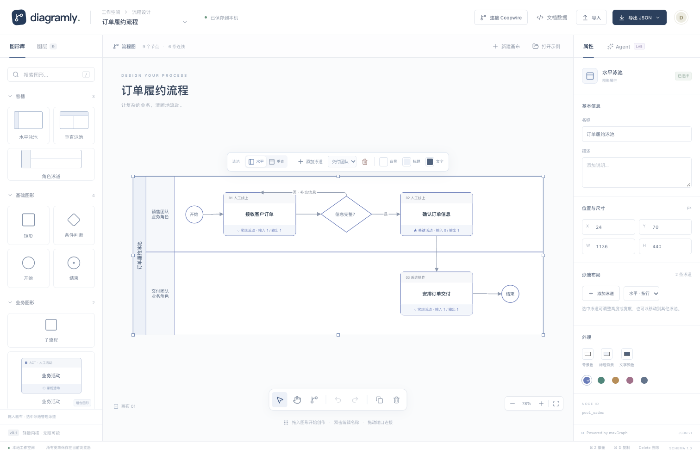

# Diagramly

一个从 maxGraph 内核重新构建的图形编辑器。业务文档、图形定义与画布引擎独立，界面和 Agent 共用结构化命令。



## 本地运行

需要 Node.js 24（见 `.nvmrc`）。这个工作区原来的默认 Node 14 无法运行当前工具链。

```sh
nvm use
npm ci
npm run dev
```

打开终端输出的本机地址。生产构建：`npm run build`。

## 当前已经实现

- Vue 3 + TypeScript 编辑工作台，基于 `@maxgraph/core@0.25.1` 的 `BaseGraph`，按需注册图形、路由和交互插件。
- 水平/垂直泳池、归属泳道、矩形、判断、子流程、开始、结束、组合业务活动；点击或拖入图形，选择、移动、缩放、双击编辑名称。
- 组合活动的标题、编号、类型、关键活动标记、输入输出计数随业务属性派生；内部部件不能单独选择、连接或删除。
- 固定端口连线、正交自动路由、连线标签编辑；可拖动端口，或使用连接工具依次选择起点和终点。
- 选中泳池的浮动工具栏支持泳道增删、方向切换、背景/标题/文字颜色；支持跨泳池移动泳道、整体移动和尺寸联动。
- 业务属性、位置尺寸、颜色与泳道归属编辑；泳道内坐标使用相对坐标，越界操作被拒绝并恢复视图。
- 复制生成新节点和新实体 ID；复制清除外部业务引用；删除清理关联连线；批量操作作为一次撤销步骤。
- 文档 JSON 导入导出、浏览器本机自动保存、重载恢复；导入校验 Schema、引用、尺寸、端口和归属。
- Coopwire 远程接口：连接既有流程与组织，活动创建/复制/编辑、描述/IO、角色归属、带版本的 XML/关系/PNG 保存；失败恢复记录及远程撤销重做。
- Agent 命令实验台：生成示例 → 校验与预览 → 应用；版本检查、会话内请求去重和撤销历史与 UI 共用。

快捷键：`V` 选择、`H` 平移、`C` 连接、`Esc` 退出、`⌘/Ctrl Z` 撤销、`⇧⌘/Ctrl Z` 重做、`⌘/Ctrl D` 复制、`Delete` 删除。右键拖动也可平移。

## 代码入口

```text
src/
  domain/                 纯 JSON 模型、运行时 Schema、业务一致性校验
  application/            原子命令、预览、历史、版本控制、示例文档
  shapes/                 图形注册表、端口、组合图形布局（不依赖 maxGraph）
  adapters/maxgraph/      maxGraph 投影、事件转命令、实例级扩展
  adapters/storage/       本机保存、JSON 导入导出
  adapters/coopwire/      真实旧接口适配、XML 转换、远程事务与恢复
  agent/                  可读取、描述、预览、应用的工具函数
  ui/                     Vue 工作台和属性面板
```

- [泳池与泳道操作](docs/pools.md)：水平/垂直布局、工具栏、容器命令与兼容。
- [Coopwire 接入与鉴权配置](docs/coopwire-integration.md)：远程调用、失败恢复、兼容与联调范围。
- [架构与扩展设计](docs/architecture.md)：数据组织、组合图形、命令与 Agent 接入方法。
- [旧项目分析与迁移清单](docs/legacy-audit.md)：基于旧仓库所有本地引用可达的 1,765 个提交，及关键功能源码和补丁。
- [完整提交索引](docs/research/legacy-commits.md) / [逐提交文件变更清单](docs/research/legacy-history.json)。

## 验证

```sh
npm test
npm run build
npm run test:e2e
```

浏览器测试默认使用 Playwright 管理的 Chromium。可设置 `PLAYWRIGHT_CHROMIUM_PATH` 使用已有 Chrome；首次使用默认浏览器需先运行 `npx playwright install chromium`。

已验证：80 项核心/接口测试、31 项真实浏览器测试及生产构建通过。

核心测试覆盖事务回滚、复制身份隔离、幂等、版本冲突、预览、撤销重做、循环图、容器约束及非法文档。浏览器测试覆盖真实画布操作、属性联动、拖动、连线、本机恢复、导出导入和 Agent 操作。

## 明确的边界

这是可运行的第一版基础工程。已接入既有 Coopwire 后端、组织字典、活动 CRUD、远程保存与受限的旧 XML 转换。尚未迁移全部业务表单、完整权限/编辑锁生命周期、快照服务、多人协同、任意历史 XML/stencil、面向用户的 PDF/图片导出、多页、容器复制、自动布局与流程编号。Agent 面板没有连接 LLM 或 MCP 服务。

远程模式与本机画布分别缓存；远程会话通过明确按钮连接。旧后端多接口不提供跨接口原子事务，已实现确认后提交、步骤日志与不确定写入停止重发，详见接入文档。

本机保存只有一份画布；导入或打开示例会替换它。撤销历史和命令去重仅在当前编辑会话内有效。当前历史使用有界快照，投影复用 Cell，但每次提交仍遍历全文档，尚未进行万节点性能验证。

maxGraph 的升级仅涉及依赖和适配器；升级仍需运行契约与浏览器回归，不承诺上游 API 不变。项目不修改上游源码，不引入 draw.io 编辑器、云盘、模板库或桌面端代码。

构建当前会提示 maxGraph 内部保留的 eval 函数和单个 JS 包超过 500kB；未屏蔽这些提示。适配器显式关闭 allowEval，生产 JS 约 743kB / gzip 205kB，后续可按加载场景拆包。

业务活动、判断与子流程的完整详情入口位于右侧「查看业务详情」，支持补充说明、差异、应用设备、时间及周期等字段，参见 [业务图形详情](docs/activity-details.md)。

代码统一使用 Prettier 格式化：`npm run format`；提交前检查 `npm run format:check`。提交信息与代码注释使用中文，每项功能验证完成后分别提交。
