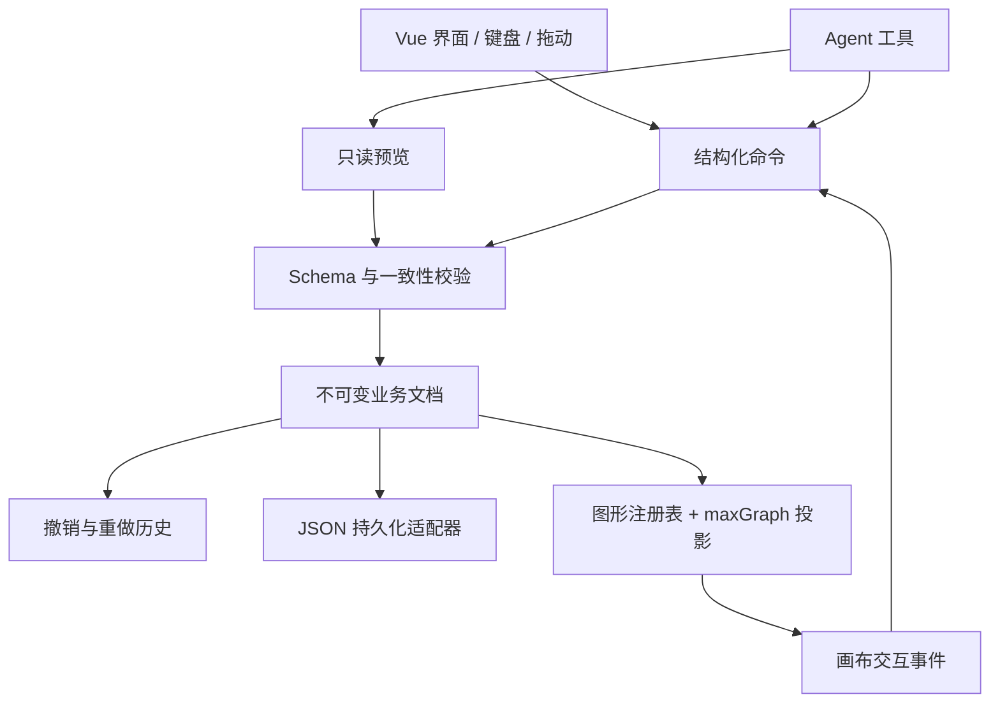

# Diagramly 架构与扩展设计

远程能力已在基础架构上实现，完整接口、鉴权和事务边界见 [Coopwire 接入文档](coopwire-integration.md)。

## 决策：maxGraph 作为引擎，业务文档作为数据源

选择 maxGraph。mxGraph 的公开版本已经停止维护，maxGraph 延续其图模型并提供 TypeScript 和模块化能力。官方明确建议生产应用使用 `BaseGraph`，按需注册特性。我们已将依赖固定为 `0.25.1`，适配器显式注册矩形、圆、菱形、连线、三个 perimeter、一个箭头、正交路由和必要交互插件。

参考：[maxGraph 项目及历史](https://github.com/maxGraph/maxGraph)、[Graph 与 BaseGraph](https://maxgraph.github.io/maxGraph/docs/usage/graph/)、[插件机制](https://maxgraph.github.io/maxGraph/docs/usage/plugins/)。线上文档包含开发中变更，实际编译与实现以锁定 npm 包中的类型和源码为准。

没有从 draw.io 删除不需要的功能；新工程只引入绘图内核。没有修改引擎源码或全局 prototype，必要行为通过引擎公开的实例级 hook 适配。



`domain` 不导入引擎或 Vue。图形定义只返回纯描述对象。只有 `adapters/maxgraph` 理解 `Cell`、`Geometry` 和 SVG。将来可独立做只读查看器或替换渲染器。

## 数据组织

```ts
interface DiagramDocument {
  schemaVersion: 1; // 文件格式版本
  id: string;
  title: string;
  revision: number; // 每次提交/撤销/重做都递增
  policies: { activityRequiresLane: boolean };
  nodes: Record<string, DiagramNode>;
  edges: Record<string, DiagramEdge>;
  entities: Record<string, BusinessEntity>;
}
```

| 概念            | 存放内容                                             | 身份与约束                                    |
| --------------- | ---------------------------------------------------- | --------------------------------------------- |
| Node            | 图形类型/版本、边界框、容器 ID、外观、实体引用       | 节点 ID；一个图形实例一个 ID                  |
| Entity          | 名称、说明、活动类型、编号、输入输出、关键标记、角色 | 当前版本一个节点独占一个实体 ID               |
| externalRef     | 外部系统与其业务 ID                                  | 可显式引用同一外部业务，不混用为节点或实体 ID |
| Edge            | 源节点/端口、目标节点/端口、标签                     | 连线 ID；端点必须存在且方向合法               |
| ShapeDefinition | 默认/最小尺寸、端口、组合布局函数                    | 类型 + shapeVersion；属于代码插件，不存入文档 |
| 投影部件        | 活动标题、头部、底部、泳道标题                       | `${nodeId}::${partKey}`；只存在引擎中         |

实体单独建表避免图形位置、颜色与业务属性混成一个 Cell value。当前一个节点对应一个实体是明确的所有权策略，解决复制误共享；未来若需要多个视图引用同一实体，应引入显式引用节点并修改约束，而不是偶然复用 ID。

JSON 不保存 DOM、HTML 标签、Vue observable、样式字符串或内部子 Cell。用户文本以纯文本绘制，引擎 `allowEval` 关闭，文件不能带可执行图形脚本。自定义布局函数是受信任工程代码。

`parentId` 表示真实业务容器，泳池内泳道另用连续 `laneOrder` 表示顺序，活动内部部件没有业务 `parentId`。顶层坐标属于画布；泳道子节点坐标属于泳道。当前支持「泳池 → 泳道 → 业务节点」层级，不支持泳道内嵌套容器。水平泳道左侧预留 80px，垂直泳道顶部预留 52px 标题区，其他边缘按统一布局规则保留空间。详见 [泳池设计](pools.md)。移动或缩小使子节点越界时，整个命令失败。

当前输入输出是字符串数组，用于验证编辑与渲染链路；旧系统的附件、文档、数据对象、系统、设备、接口等应通过后续有版本的领域类型扩展，不能把完整后端对象直接塞进渲染字段。

## 新建一个专业的组合图形

已有 `activity` 是完整示例：头部显示编号与活动类型，中部显示名称，底部显示关键标记及输入输出计数。

1. 在 `src/shapes/registry.ts` 注册唯一 `type`、版本、分类、默认尺寸、最小尺寸及端口。
2. 简单图形选择基础 primitive；组合图形提供 `composite(node, entity)`，返回带稳定 key 的部件。
3. 布局根据节点宽高和业务属性计算。`::header`、`::title`、`::footer` 是派生部件标识，不能被 Agent 或业务 API 引用。
4. 调用 `Editor.createNode` 生成节点和实体，再使用命令提交。不直接 `graph.insertVertex` 创建业务节点。
5. 若需要新业务字段，扩展实体 Schema、编辑表单和迁移器；新校验必须在领域层生效，不能只限制某个按钮。
6. 若需要新的 SVG primitive，仅在引擎适配器注册对应引擎形状，保持业务插件不依赖引擎对象。

图形库自动读取注册表；渲染适配器将描述转成引擎部件。部件不接收选择、连接、删除或移动操作，鼠标选择归一到所属节点。业务更新只改实体，下一次投影重新计算布局。

真实分组与组合图形不同：用户把若干独立业务节点分组，应保留成员节点身份；一个活动的标题、图标则不应具有业务节点身份。当前尚未实现任意分组，避免将这两种概念混用。

## 命令协议与事务

所有编辑都经过 `Editor.submit`：本机模式调用 `execute`；远程模式必须等待 transport 确认，直接调用同步 execute 会被拒绝。界面使用 `dispatch` 自动填写 envelope；Agent 或服务端可以显式提供完整 envelope。

```json
{
  "commandId": "cmd_example_001",
  "expectedRevision": 0,
  "origin": "agent",
  "label": "调整订单活动",
  "operations": [
    {
      "type": "node.update",
      "id": "receive",
      "patch": { "name": "核对客户订单", "critical": true }
    },
    { "type": "edge.update", "id": "edge_yes", "patch": { "label": "资料完整" } }
  ]
}
```

支持 `node.create/update/move/resize/appearance/delete/duplicate`、`edge.create/update/delete`、`document.rename`。采用明确操作类型，不暴露任意对象路径或执行代码的命令。

执行过程：严格 Schema 校验 → 命令 ID 去重 → revision 检查 → 在草稿副本应用整批操作 → 校验最终文档 → 一次提交、记录历史和 receipt → 通知投影与持久化。

- 整批只产生一个 revision 和一个撤销步骤。中间草稿不会被展示、保存或通知；允许同一批先引用稍后才创建的节点。
- 同一会话中相同命令 ID 与相同解析后 payload 返回原 receipt；同 ID 不同 payload 被拒绝。该比较是严格的序列化比较，不承诺语义等价的不同 JSON 键顺序会视作相同。
- `expectedRevision` 解决失效写入，不等同多人实时合并。冲突后重新读取、重新生成并预览命令。
- 撤销恢复业务状态，但 revision 单调递增。重做恢复同一组 ID；新命令清空旧的 redo 分支。
- 复制生成新节点/实体 ID，清空外部业务引用与业务编号。复制远程业务必须走后端独立流程；不靠监听 CHANGE 再扫描修补重复 ID。
- 删除泳道级联其节点、实体与相关连线，作为一个事务，可以完整撤销。是否允许含活动的泳道删除属于产品策略，可替换为领域规则。
- 历史最多保留 100 步快照；最近操作记录 50 条。去重 receipt 仅在当前 Editor 会话保留，没有伪装成数据库审计记录。

引擎交互先由 maxGraph 绘制预览/变更局部几何，适配器在语义事件上提交命令；校验失败立即用文档恢复投影。渲染期间有重入标记，防止投影自身再次派发业务命令。端口连接直接转命令，不依赖泛化 CHANGE 监听去触发网络请求。

投影目前复用有稳定 ID 的 Cell，根据签名重建变化的内部部件；每次命令仍遍历全文档。后续应使用 receipt 变化集、增量派生、patch 历史与性能基准替换全量遍历/快照，不能仅凭“使用 maxGraph”就承诺大规模性能。

## Agent 接入

`createAgentTools(editor)` 已提供可测试的本地函数：

| 工具     | 当前实现                                                       |
| -------- | -------------------------------------------------------------- |
| describe | 输出图形能力、端口、最小尺寸和命令 JSON Schema                 |
| read     | 返回结构化文档副本；不能通过修改返回对象改变编辑器             |
| preview  | 校验命令，返回下一版本、变更节点 ID 和预览文档；不修改当前状态 |
| apply    | 使用相同命令协议提交；参与版本控制、去重和撤销                 |

UI 的 Agent LAB 只是上述函数的实验台，没有联网、模型密钥或假模型回复，也没有公开写入全局对象。

宿主服务可以将函数映射为 `diagram.read`、`diagram.preview`、`diagram.apply` 等 MCP/Function Calling tools。模型先读取 `describe + read`，生成明确节点 ID 和 expectedRevision 的命令，再预览。工具执行者负责租户权限、范围限制与审计，远程服务应再次校验；前端按钮或 origin 字段不是鉴权。

当前已通过 `CoopwireSession` 接入旧业务接口，使用步骤日志处理多接口确认与失败。若增加服务端统一 command handler，应持久化命令 ID、业务副作用与新文档版本；使用事务或 outbox/补偿处理失败。不能先乐观复制外部业务，再依赖画布事件去去重，也不能把前端 undo 等同于撤销已经发生的后端业务操作。

## 保存、迁移与升级

当前 `LocalStorage` adapter 使用一个 v1 键，400ms 合并保存，pagehide 再写一次。JSON 导入最大 5MB，严格拒绝未知 Schema、无效 ID/实体/端点/端口/容器与尺寸。导入成功整体替换工作文档，失败保留当前文档。本机自动保存不提供跨设备同步或跨标签页冲突保护。

已提供 `adapters/coopwire/codec.ts` 受限迁移器，覆盖本次真实流程的类型并保留原 XML 备份。通用历史兼容仍需按以下流程扩展：解压/解析 → 识别活动根与泳道 → 分离节点 ID、data-id 和外部业务引用 → 根据活动属性恢复实体 → 忽略派生子 Cell → 将连线端点提升到活动根 → 映射类型/端口和坐标 → 输出迁移诊断 → 校验 JSON。未知 stencil、重复远程 ID、富文本和无法映射端口应报告，不允许静默丢弃。

升级 maxGraph：改固定版本与 lockfile → 查看 breaking changes → 在适配器调整 API → 核心命令测试 → 浏览器拖动/缩放/连线/组合部件/导入导出回归。领域文档无需跟随引擎 API 改版。`schemaVersion` 与 `shapeVersion` 单独演进；当前版本未提供 v2 迁移，未知版本直接拒绝。

## 后续实施顺序

1. 选择真实业务样图和旧 XML fixture，确定必须兼容的类型、字段和权限；完成迁移器并做数据对账。
2. 既有业务与远程保存适配器已实现；进一步补充后端统一事务接口，提供跨客户端幂等与事务保证。
3. 根据业务优先级补齐子流程、引用活动、并行/阶段、输入输出详情与角色字典。
4. 加入真正的 Agent transport、用户审阅交互与服务端鉴权审计。
5. 协同单独验证。若用 Yjs，优先对规范化文档建模，明确实体/节点删除规则、冲突合并、持久化与 scoped undo；不要只把引擎 Cell 操作追加到共享数组就当作领域一致性已经解决。
6. 根据性能基准补充增量投影、布局、SVG/PNG/PDF 导出、多页及大型图优化。
